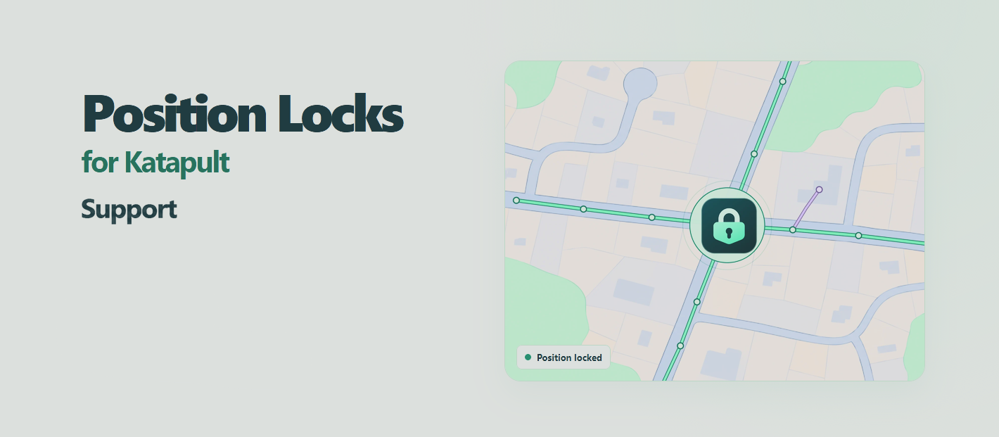

  

# Position Locks for Katapult

Support and privacy information for the independent Position Locks Chrome extension.

The support guide covers version **0.3.5**, including how to unlock, drag, lock, and reset the movable toolbar. The privacy policy explains its locally stored placement preferences.

[Home](https://azx-215.github.io/position-locks-offical/home) · [Support](https://azx-215.github.io/position-locks-support/support) · [Privacy policy](https://azx-215.github.io/position-locks-support/privacy)

Open a GitHub issue at https://github.com/AZX-215/position-locks-support/issues/new with the extension version, Katapult release channel, mode (**Single Node** or **All Job Nodes**), steps, and expected and actual results. Use a synthetic job and redact client details, credentials, addresses, and job URLs from screenshots and examples.

This repository contains the support pages and privacy policy. It contains no client data or private extension source. GitHub account notifications are controlled by each participant; email delivery has not been tested.
